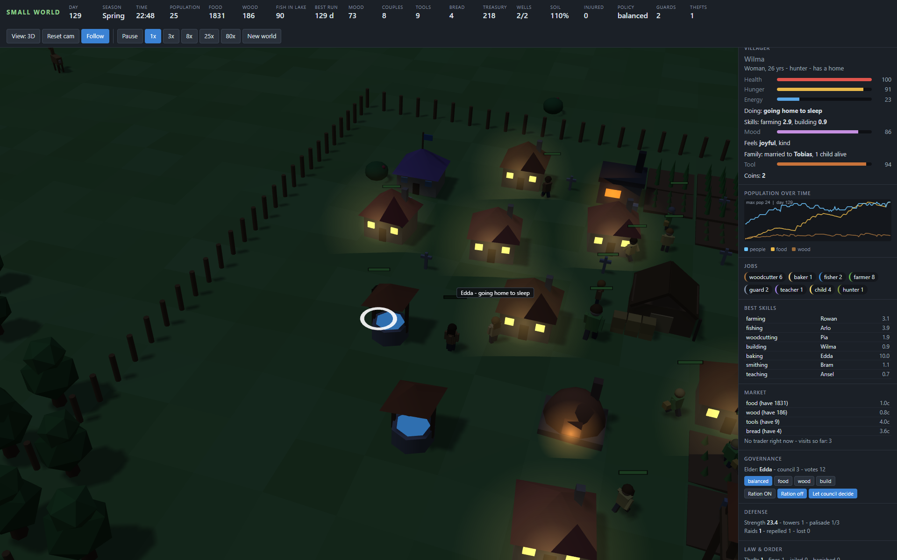
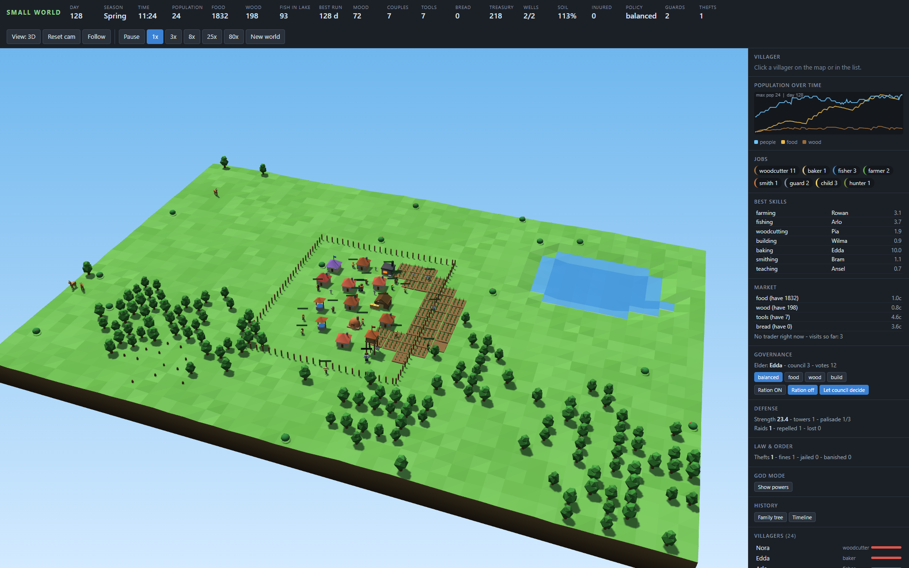

# Small World

A browser-based **village survival simulation**. Ten settlers arrive at a lake. You don't control them directly: they farm, fish, chop wood, build, marry, argue, steal, fight raiders and die of old age on their own. Your job is to watch, nudge and try to keep the village alive for as many days as possible.

No build step, no dependencies to install, no backend. It is plain JavaScript plus a bundled copy of [three.js](https://threejs.org/) for the 3D view.



<details>
<summary>More screenshots</summary>



</details>

## Highlights

- **Autonomous villagers.** Each person has needs (hunger, energy, health), a trait, skills, a mood, a family and a job. They plan their own days.
- **Self-balancing economy.** Jobs are reassigned twice a day from live food/wood/housing shortfalls. Fields lose fertility and need fallow time. Winter kills crops and freezes people who have no firewood.
- **Free will.** Villagers have job preferences ("callings"), memories and personal goals (master a craft, befriend, court), and can quit a job they hate. A built-in life recorder keeps a dossier for everyone, to study how they live and die (`node lives.js`). Both can be switched off with `new World({ free: false, rec: false })`.
- **Society.** Marriage and children, friendships and rivalries, grief, an elected elder and council, a market with visiting traders, crime and punishment.
- **Things go wrong.** Drought, blight, plague, cholera, house fires, wildfire, floods, earthquakes, wolves and armed raiders.
- **3D and 2D views.** A three.js diorama with a day/night cycle, seasons and an orbit camera, or a lightweight 2D canvas.
- **Deterministic.** The same seed always produces the same world, so runs are reproducible and testable.
- **Pluggable.** Almost every feature is a self-contained "mod" file in [`mods/`](mods). The simulation core also runs headless in Node.

## Quick start

You need a modern browser. Node.js is optional.

**Option A: open the file.** Double-click [`index.html`](index.html). It works from `file://`.

**Option B: tiny local server.**

```bash
node serve.js          # http://localhost:8765
node serve.js 3000     # custom port
```

The server only serves static files. It is a convenience, not a requirement, and it stops when you close the terminal or restart your machine.

## Controls

| Input | Action |
| --- | --- |
| `Space` | Pause / resume |
| `1` `2` `3` `4` `5` | Speed 1x / 3x / 8x / 25x / 80x |
| Click a villager (map or list) | Inspect them |
| **View: 3D / 2D** button | Switch renderer (choice is remembered) |
| 3D: drag | Rotate camera |
| 3D: right-drag, middle-drag or Shift-drag | Pan |
| 3D: mouse wheel | Zoom |
| 3D: double-click a villager, or **Follow** | Camera follows them |
| **Reset cam** | Reset the 3D camera |
| **New world** | Start a fresh random world |

The right-hand sidebar shows the selected villager, a population chart, job counts, and one panel per feature (market, governance, defense, law and order, history, callings, ambitions, the life recorder, and God mode). Click **Life stories** to read how each villager lived, or **Export** to download everything as JSON.

## How a run works

Time runs at 30 ticks per second at 1x. A day is 240 ticks (about 8 seconds), a season is 10 days and a year is 40 days. The run ends when the last villager dies or leaves. Your score is the number of days survived, stored as **Best run** in your browser's `localStorage`.

Using any God mode power flags the run, and it no longer counts toward your record.

Full rules are in the wiki ([start at Home](docs/wiki/Home.md)): [Gameplay Guide](docs/wiki/Gameplay-Guide.md), [Simulation Mechanics](docs/wiki/Simulation-Mechanics.md) and [Events and Disasters](docs/wiki/Events-and-Disasters.md).

## Project layout

```
index.html        page shell: HUD, canvas, sidebar, ordered <script> list
style.css         dark UI theme
sim.js            simulation core (World, jobs, planner, events), no DOM
ui.js             2D renderer, HUD, panels, input, game loop
view3d.js         three.js 3D renderer and orbit camera
mods/             feature modules (20 of them) + load.js (Node loader)
lib/              bundled three.js (MIT)
serve.js          static file server
headless.js       balance test: many seeds, no UI
smoke.js          regression test: invariants + every event + determinism checks
lives.js          study how villagers lived and died (dossiers, export)
fingerprint.js    hash end states to prove a change did not alter behaviour
probe.js          inspect any world value at a given day
trace.js          day-by-day economy trace
starve.js         find days when people starve despite food in stock
addmod.js         register a new mod in load.js and index.html
```

## Running without a browser

The core has no DOM dependency, so you can simulate in Node:

```bash
node smoke.js 120 3            # regression test (exit code 1 on failure)
node headless.js 10 400        # 10 seeds, up to 400 days, print outcomes
node probe.js 1003 150 "w.m.market"   # evaluate an expression on day 150
node trace.js 1004 4 120       # economy snapshot every 4 days
node starve.js 1003 400        # starvation-with-food diagnostic
```

```js
const { World } = require('./sim.js');
const w = new World({ seed: 42 });
while (!w.gameOver && w.day < 100) w.step();
console.log(w.day, w.agents.length, w.stock);
```

## Writing a mod

A mod is one file that pushes hooks, jobs, events, buildings, panels and sprites onto a shared registry. No core changes are needed.

```js
// mods/hello.js
(function () {
  'use strict';
  const api = typeof module !== 'undefined' && module.exports ? require('../sim.js') : window.SmallWorld;

  api.mods.push({ day(w) { if (w.day % 10 === 0) w.log('Ten days have passed.', 'info'); } });
  api.hud.push({ id: 'hello', label: 'Hello', get: w => w.day });
})();
```

```bash
node addmod.js hello    # registers it in mods/load.js and index.html
node smoke.js           # make sure nothing broke
```

See the [Modding Guide](docs/wiki/Modding-Guide.md) and [Architecture](docs/wiki/Architecture.md).

## Documentation

Long-form docs live in [`docs/wiki`](docs/wiki) and are published to the GitHub Wiki automatically by [`.github/workflows/publish-wiki.yml`](.github/workflows/publish-wiki.yml). See [`docs/README.md`](docs/README.md) for the one-time setup.

## Contributing

Issues and pull requests are welcome. Before opening a PR, run:

```bash
node smoke.js 120 3
node headless.js 5 300
```

`smoke.js` must print `ALL OK`. If you change balance, include before/after output from `headless.js`.

## Credits and license

- 3D rendering uses [three.js](https://threejs.org/) r149, bundled in [`lib/`](lib) under the MIT license ([`lib/three.LICENSE`](lib/three.LICENSE)).
- Small World's own code is released under the [MIT License](LICENSE).
