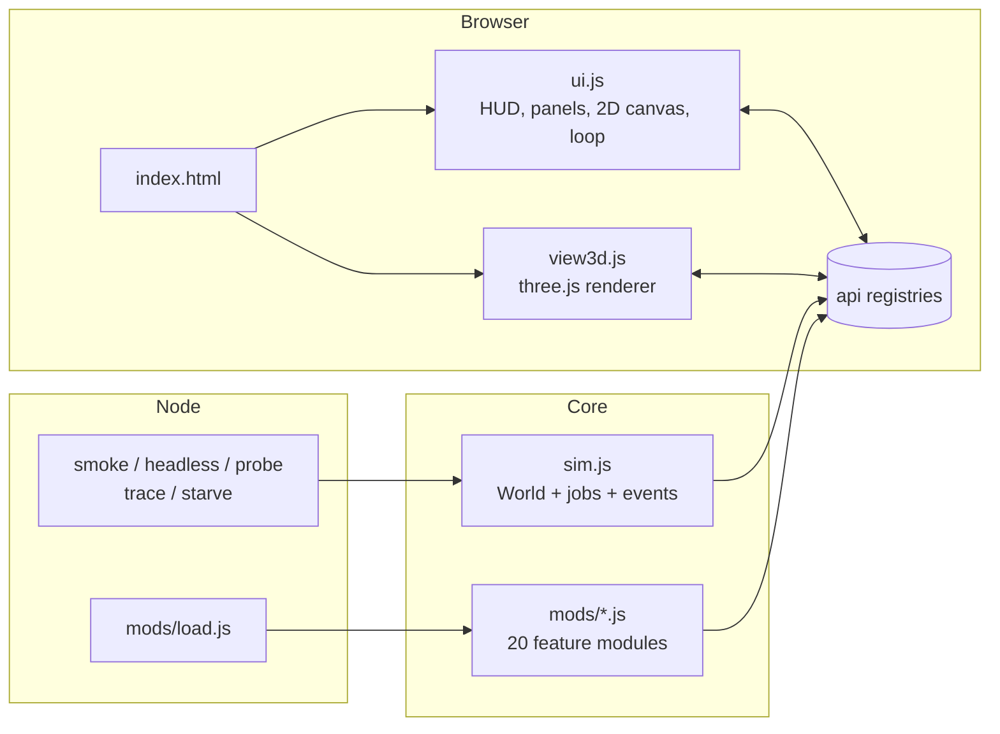

# Architecture

## Overview



- **`sim.js`** is pure logic and does not touch the DOM. It exports a `World` class and a shared `api` object.
- **`mods/*.js`** add behaviour by pushing onto `api` registries. Each file is an independent IIFE.
- **`ui.js`** and **`view3d.js`** read the `World` state and the UI registries. They never change simulation rules.
- **Node tools** `require('./sim.js')`, which then loads every mod through `mods/load.js`.

The same files run in both environments. Each mod begins with:

```js
const api = typeof module !== 'undefined' && module.exports ? require('../sim.js') : window.SmallWorld;
```

In the browser, `sim.js` publishes `window.SmallWorld`. In Node it sets `module.exports` and then requires `mods/load.js`.

## Load order

Browser: the `<script>` tags in `index.html` in this order: `three.min.js`, `sim.js`, `view3d.js`, then the mods (`mods/eras.js`, then the browser-only `mods/buildings3d.js`), `ui.js`.
Node: `mods/load.js` requires the same mods in the same order.

> Keep `index.html` and `mods/load.js` in sync. `node addmod.js <name>` does this for you.

Order matters because hooks run in registration order and some mods read state created by earlier ones. For example `jobs.js` reads `w.store`, and `crime.js` reads `w.m.gov`. The current order is:

`skills, mood, family, relations, tools, jobs, market, wells, soil, fire, disasters, injury, governance, defense, crime, god, history, personality, goals, eras, recorder`

`personality` and `goals` read `a.rel` and skills from earlier mods and add job preferences and memories. `recorder` is last on purpose: as a passive observer it must see the final state after every other mod has acted. `ui.js` is always loaded after all mods.

## The `World` object

| Field | Purpose |
| --- | --- |
| `seed`, `rng` | Seeded `mulberry32` generator. Use `w.rng()` and `w.rint(a, b)` for all simulation randomness |
| `terrain` | `Uint8Array(44 x 30)`: 0 grass, 1 lake, 2 flood water |
| `occ` | Array of what occupies each tile (tree, bush, house, plot, struct, site, storehouse) |
| `trees, bushes, houses, plots, sites, structs` | Entity lists. `structs` holds modded buildings (forge, oven...) |
| `store` | The storehouse `{x, y}` |
| `agents` | Living villagers. `byId` maps id to agent. `registry` keeps everyone ever |
| `stock` | `{food, wood, bread, tools}` shared stockpile |
| `fish` | Lake fish count (0..100) |
| `policy` | `{priority, ration}` |
| `targets` | Food and wood targets for this season |
| `m` | **Per-mod state.** Each mod stores its data under `w.m.<name>` |
| `logs`, `chron` | Chronicle and key-event history |
| `stats` | Births, deaths, causes, arrivals, peak |
| `tick`, `day`, `season`, `year`, `dayFrac` | Time |
| `gameOver`, `endCause`, `godUsed` | Run state |

## The `api` registries

### Simulation registries (`sim.js`)

| Registry | Type | Used for |
| --- | --- | --- |
| `api.mods` | array of hook objects | Reacting to lifecycle events (see below) |
| `api.jobs` | object keyed by job name | `{plan, weight, cap, min, group, skill, color}` |
| `api.events` | array | Random and God-mode events `{id, label, cat, w, ok, run, manual}` |
| `api.needs` | array of functions | Building requests `fn(world) -> need or [needs] or null` |
| `api.actions` | object | Handlers for UI buttons with `data-act="name"` |
| `api.util` | object | `clamp, nearestTo, mv, mulberry32` |
| `api.consts` and top-level | | `W, H, DAY, SEASONS, SEASON_DAYS, YEAR, ADULT_AGE, HOUSE_CAP, HOUSE_COST, FISH_MAX` |

### Presentation registries (used by `ui.js`)

| Registry | Type | Used for |
| --- | --- | --- |
| `api.hud` | `{id, label, get(w)}` | Extra stats in the top bar |
| `api.panels` | `{id, title, html(w, ui)}` | Sidebar panels. Return `null` to hide |
| `api.info` | `(agent, w) => html` | Extra lines on the villager card |
| `api.icons` | `(agent, w) => [text, colour] or null` | Badge above a villager |
| `api.alerts` | `(w) => string or null` | Red banner message (first non-null wins) |
| `api.sprites` | `{kind: (G, struct) => void}` | 2D sprite for a structure kind |
| `api.draw.ground`, `api.draw.top` | arrays of `(G) => void` | 2D layers below and above the entities |
| `api.models3d` | `{kind: (T, struct, w) => {obj, upd?}}` | 3D model for a structure kind |
| `api.jobColors` | object | Colours for non-job labels |
| `api.overHtml` | array of `(w) => html` | Extra buttons on the game-over card |

`G`, passed to 2D draw functions, provides `ctx`, `ts` (tile size), `gx(x)`, `gy(y)` (tile to pixel), `world`, `night`, `season`, `time`, `hash`.

## Hook reference

Hooks are methods on objects pushed to `api.mods`. The core calls them through three helpers:

| Helper | Behaviour |
| --- | --- |
| `w.hook(name, ...args)` | Calls the hook on **every** mod |
| `w.hookFirst(name, ...args)` | Stops at the first mod that returns a truthy value and returns it |
| `w.hookProd(name, ...args)` | Multiplies all returned numbers together (start value 1) |
| `w.hookSum(name, ...args)` | Adds all returned numbers together (start value 0) |

| Hook | Called | Arguments | Kind | Purpose |
| --- | --- | --- | --- | --- |
| `init` | World created | `(w)` | all | Create `w.m.<name>` state |
| `spawn` | Villager created | `(w, a)` | all | Add fields to the villager |
| `tick` | End of every tick | `(w)` | all | Continuous simulation (animals, fire, raiders) |
| `day` | Start of a day | `(w)` | all | Daily logic |
| `dusk` | 75% through the day | `(w)` | all | Evening logic |
| `history` | After the daily history point is built | `(w, point)` | all | Add chart data |
| `birth` | A child is born | `(w, child, mother, father)` | all | |
| `die` | Villager dies | `(w, a, cause)` | all | |
| `leave` | Villager leaves | `(w, a, why)` | all | |
| `hurt` | Villager injured | `(w, a, amount, cause)` | all | |
| `built` | A structure is added | `(w, struct)` | all | |
| `houseLost` | A house is destroyed by a disaster | `(w, house, cause)` | all | |
| `work` | A skill gains experience | `(w, a, skill)` | all | |
| `ate` | A villager eats | `(w, a, 'food'\|'bread')` | all | |
| `vitals` | Every tick per villager | `(w, a, hit)` | all | Call `hit(damage, cause)` to hurt them |
| `wolves` | Wolves appear | `(w, wolfList)` | all | |
| `workMult` | Computing a task time | `(w, a, skill)` | product | Return a speed factor |
| `yieldMult` | Harvest, wood, fishing, berries | `(w, a, 'farm'\|'wood'\|'fish'\|'forage')` | product | Scales how much is gathered |
| `heatCost` | Winter dusk heating | `(w)` | product | Scales the 1.5 wood per house |
| `eventMult` | Weighting random events | `(w, event)` | product | Return 0 to disable an event, below 1 to make it rarer |
| `lockedBuild` | Building needs list | `(w, need)` | first | Return `true` to hide a need until unlocked |
| `lockedJob` | Job planner | `(w, jobName)` | first | Return `true` to give a job no workers. Never lock farmer, fisher or woodcutter |
| `speedMult` | Moving | `(w, a)` | product | Return a speed factor |
| `portion` | Eating | `(w, a)` | product | Scales how much hunger food restores |
| `fightMult` | Fights | `(w)` | product | |
| `urgent` | `think()`, first priority | `(w, a)` | first | Return a plan to pre-empt everything |
| `needs` | `think()`, after sleep | `(w, a)` | first | Return a plan for a personal need |
| `child` | `think()` for children | `(w, a)` | first | |
| `idle` | `think()` in daytime | `(w, a)` | first | Low-priority personal tasks |
| `homeFor` | Choosing a house | `(w, a)` | first | Return a preferred house |
| `raidBlock` | Before a theft event | `(w)` | first | Return `true` to stop it |
| `jobAffinity` | Job planner scoring a person for a job | `(w, a, job)` | sum | Return a bonus or penalty in skill points |
| `quitJob` | Job planner, per worker who would keep their job | `(w, a)` | first | Return `true` to make them leave it |
| `jobsAssigned` | After every job reshuffle | `(w)` | all | Observe who got what |
| `decided` | End of `think()` | `(w, a, plan)` | all | Observe what a villager chose (read-only) |
| `lifeEvent` | Raised by `mods/goals.js` | `(w, a, kind, text, otherId)` | all | Memories, goals met or failed |

## Plans and steps

A *plan* is `{ steps: [...], claims: [...], kind }`.

| Step | Shape | Notes |
| --- | --- | --- |
| Move | `mv(x, y, label)` | Breadth-first pathfinding over grass, 8 directions, no corner-cutting |
| Work | `{t:'work', ticks, label, check?, done?, optional?}` | `check` runs before it starts. If false, the plan ends (or the step is skipped when `optional`). `done` runs when finished |
| Sleep | `{t:'sleep', nap?, label}` | Ends when rested, or if starving |

`claims` are objects (trees, fields, deer, sites) that no one else will target until this plan ends. `kind` (for example `work`, `eat`, `sleep`, `fire`, `fight`, `jail`) lets mods tell what someone is doing. Use `w.forcePlan(a, plan)` for emergencies.

## Rendering

### 2D (`ui.js`)

Draws, in order: terrain, fields, graves, building sites, berry bushes, the `api.draw.ground` layer, then trees, houses, the storehouse, modded structures and villagers sorted together by Y (so things lower on screen overlap those behind), then the `api.draw.top` layer, the selected villager's path, a night overlay with warm window glow, snow in winter, a drought tint, and finally the hover/selection label. Click picking uses a 0.9-tile radius.

### 3D (`view3d.js`)

Builds a three.js scene from the same world: displaced terrain with a lake, seasonal grass tint, snow in winter, clouds, a sun and sky that follow the time of day, and low-poly models. Structures use `api.models3d[kind]`. A structure kind without a 3D model falls back to a grey box. `mods/buildings3d.js` (browser only, not in `mods/load.js`) replaces the default models with procedural, canvas-textured buildings: 7 house styles, 6 storehouse styles, and 3 era-banded models each for forge, oven, school, well and tower. It uses the hooks `view.makeHouseFn`, `updHouseFn`, `makeStoreFn` and `updStoreFn`, and reads `view.look` (the current era look, with `eraId`). When the era changes, `view3d.js` rebuilds each structure model in place (`refreshStruct`). No image or model files are loaded. Deer, wolves, raiders and wildfire flames are read from `w.m.deer`, `w.m.nat.wolves`, `w.m.def.raiders` and `w.m.fire.flames`. The 2D `api.draw` layers are not used in 3D. People and animals are interpolated between ticks for smooth movement. If WebGL is not available, the 3D toggle is disabled.

### Game loop

`requestAnimationFrame` accumulates `dt x speed x 30 / 1000` ticks and calls `world.step()` that many times, with a 40 ms safety budget so very high speeds drop frames rather than freeze the page.
