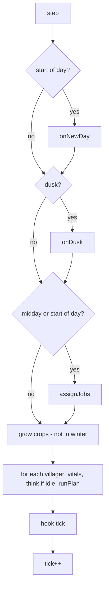

# Simulation Mechanics

Reference for the rules and numbers in `sim.js` and the mods. Constants are quoted from the source so you can tune them.

## Time

| Unit | Length |
| --- | --- |
| Tick | One simulation step. The UI runs 30 ticks per second at 1x |
| Day | 240 ticks (about 8 seconds at 1x) |
| Season | 10 days: Spring, Summer, Autumn, Winter |
| Year | 40 days |
| Dusk | 75% through the day. Heating is decided, work is interrupted, everyone heads home |
| Night | From 75% to 8% of the day. Villagers sleep. Winter nights are dangerous |

The world starts 10% into day 0. The HUD clock shows that moment as 06:00, so a new game day begins at 03:36 on the clock and night runs from about 21:36 to 05:31.

### Order of events each tick



`onNewDay` ages villagers, heals wounds by 3, counts down sickness and drought, regrows fish, trees and bushes, restores field fertility, announces seasons, applies the winter frost, runs the `day` hooks, records a history point, then runs births and random events (in that order).

## Villager needs

| Stat | Rule |
| --- | --- |
| **Hunger (satiety)** | Falls `100 / (2.6 x 240)` per tick, so a full stomach lasts 2.6 days. One food unit restores 45. One bread restores 90 |
| **Energy** | Falls 0.2 per tick while awake (about 2 days from full). Sleeping restores 1.0 per tick in the home, 0.35 outdoors |
| **Health** | Drops from the sources below. Recovers 0.06 per tick (0.12 asleep) only if there is no damage, hunger > 35, energy > 20 and injury < 60 |

### Damage per tick

| Source | Damage |
| --- | --- |
| Starvation (hunger = 0) | 0.12 |
| Exhaustion (energy = 0) | 0.06 |
| Cold (winter night, not in a heated home) | 0.10 |
| Plague | 0.07 |
| Cholera | 0.10 |
| Infected wound | 0.05 |
| Serious wound (injury > 60) | 0.03 |

A person dies at health 0, or of old age when `age > lifespan`. Lifespan is random between 55 and 85 days. Adulthood begins at 12 days.

### Movement penalties

Movement is multiplied by 0.85 for children, by 0.6 if hunger < 10 or energy < 8, and by up to 0.55 for injuries (`1 - injury / 200`, capped at 45% loss).

## How a villager decides what to do

Each villager has a *plan*, a list of steps (`move`, `work`, `sleep`). When the plan is empty, `think()` picks a new one using the first rule that applies:

1. An **urgent** mod plan (injured and heading home to recover, or serving a jail sentence)
2. **Eat** if hunger is below 30 (24 with rationing) and food exists
3. **Forage berries** if hunger is below 28 and there is no food
4. **Sleep** if it is night
5. **Nap** if energy is below 12
6. **Deliver** anything they are carrying to the storehouse
7. **Eat** if hunger is below 50 (38 with rationing)
8. **Children** play or attend school
9. **Idle** actions in daytime (fetch a tool from the storehouse, or visit a friend or a person they are courting)
10. **Do the assigned job**
11. If the job has nothing to do, **fall back** to farming, fishing, wood or foraging while food is below 1.5x target, then wood
12. Otherwise wander

After a plan is chosen the `decided` hook fires, which is how the life recorder counts decisions without influencing them.

Dusk interrupts plain work plans so everyone goes home. Emergency plans (fire, wolves, raiders) override whatever a villager is doing.

### Work speed

Duration of a task in ticks:

```
ticks = max(2, round( base / ( (1 + 0.06 x skillLevel) x modifiers x (0.8 + 0.4 x mood/100) ) ))
```

`skillLevel` is `min(10, skillPoints / 12)`. Modifiers multiply: a tool gives 1.25, an injury above 20 gives down to 0.6.

## The economy

Resources live in one shared storehouse: **food**, **wood**, **bread**, **tools**. `foodEq = food + 2 x bread`.

### Targets

Every job reassignment recalculates how much the village *wants* to have:

| Season | Food target | Wood target |
| --- | --- | --- |
| Spring | `pop x 12 + 10` | `pop x 2.5 + 30` |
| Summer | `pop x 14 + 10` | `pop x 2.5 + 30` |
| Autumn | `pop x 20 + 10` | `pop x 4 + 30` |
| Winter | `pop x 14 + 10` | `pop x 3 + 30` |

The *need* is `clamp(1 - stock / target, 0.08, 1)`. Needs weight how many workers go to food or wood.

### Job assignment

Runs at the start of each day and at midday, for adults only (children are always `child`).

1. Each job reports a **weight**, an optional **cap** and an optional **minimum**.
2. The policy priority (balanced, food, wood, build) multiplies the weight by 1.6 for jobs in that group.
3. Minimums are filled first, then the rest of the workers are shared by weight, never exceeding caps. Leftovers become woodcutters.
4. The assignment is *stable*: people keep their current job if that job still has a slot, unless a mod's `quitJob` hook lets them walk away from it (see [Callings](Villagers-and-Society.md#callings-job-preferences)). Free workers take the open job with the highest score: `skill points + random 0-2 + the sum of every mod's jobAffinity`. With `mods/personality.js` and `mods/goals.js` loaded, affinity is the villager's liking for the job (up to +/-10), a +6 bonus for a job they are trying to master and +4 for food jobs after a famine. With `free: false` it is 0 and the rule is the original skill-plus-noise.

See [Buildings and Jobs](Buildings-and-Jobs.md) for each job's weight and cap.

### Farming

| Rule | Value |
| --- | --- |
| Growing time | 4 days at base speed (`GROW_DAYS`) |
| Seasonal speed | Summer x1.15, Autumn x0.85, Spring x1, Winter: no growth |
| Drought | Growth x0.25 |
| Planting window | Days 0 to 23 of each year. Later crops would not ripen |
| Frost | On the first day of winter every *growing* field is reset. Ripe fields survive |
| Yield | `max(1, round((5 + 0..2) x fertility x (1 + 0.04 x farmingLevel)))` food |
| Fertility | Starts at 1.0, max 1.2. Each harvest costs 0.07 (min 0.2). Empty fields regain 0.05 per day, non-empty fields 0.01 per winter day. Compost adds 0.06 per day to the worst empty field when it is not winter and food >= `pop x 6`. Flood silt adds 0.3 |
| Fallow | Fields below 0.62 are not replanted |
| Field count target | `min(70, ceil(pop x 1.3) + 4)` |

A farmer harvests up to 3 ready fields per trip, replants each one if allowed, then delivers.

### Fishing

The lake's fish stock starts at 70 and grows each day by `0.25 x fish x (1 - fish/100) + 0.3`, capped at 100 (logistic growth). Each cast takes one fish (two with a `5% x level` chance). A trip is three casts. No new fishing trip starts below 30 fish, and the fisher job gets zero weight there, which slows over-fishing. The lake can still run low, and then recovers slowly because logistic growth is weakest near zero.

### Wood

Each tree holds 4 wood and regrows 4 to 7 days after it is emptied. A trip chops up to two trees. Woodcutting stops entirely when stock is above twice the target. Heating burns 1.5 wood per occupied house at each winter dusk.

### Foraging

Berry bushes hold 3 food, restore 35 hunger per berry and regrow 5 days after they are picked clean. Forage is the emergency food source.

### Housing

A house holds 4 people and costs 15 wood. Homeless villagers have worse mood (-12 instead of +6) and no heat in winter. At most 30 houses are built. Families move in together where space allows.

## Building

Any mod can request a building through `api.needs`. A builder:

1. Finds a free site close to the storehouse, with spacing rules (houses are not adjacent to other buildings).
2. Fetches timber from the storehouse (or uses wood already carried).
3. Carries it to the site and works for the building's `ticks`, scaled by building skill.
4. The structure appears, a `built` hook fires, and the builder gains 3 building skill.

Only one site per kind exists at a time.

## Logging

`world.log(text, type)` writes to the Chronicle. Types are `info`, `good`, `bad`, `mile` (milestone), `birth` and `death`. Entries of type `good`, `bad` and `mile` are also kept for the end-of-run [timeline](Testing-and-Tools.md).

## Randomness

All simulation randomness comes from a seeded `mulberry32` generator (`world.rng`). The same seed and the same inputs always yield the same world. `Math.random` is used only for the default seed and for cosmetic effects in the 3D view (clouds, snow).
